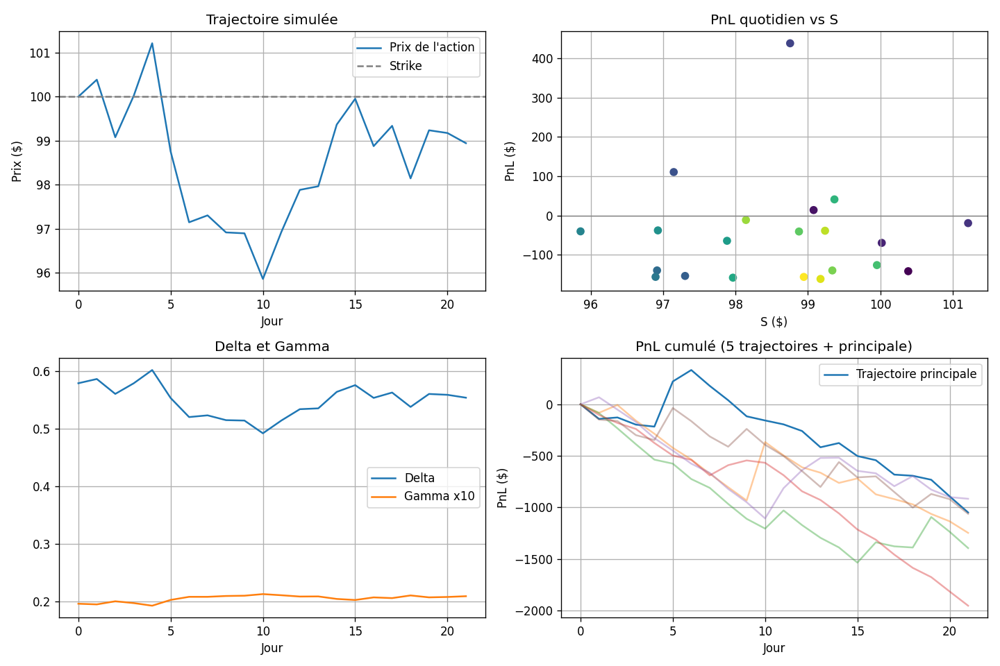

# Delta-hedging d'un call equity (Black-Scholes)

Simulation en Python d'une stratégie de **delta-hedging dynamique** pour un call vanille ATM 1 an, dans la peau d'un flow trader : attribution du PnL quotidien, Greeks (delta, gamma, vega) et mesure de l'efficacité de la couverture.



## Problème

Un client achète un call ATM 1 an. Pour ne pas subir les mouvements de l'action, on détient chaque jour `-Δ × 10 000` actions (100 contrats × 100 actions) et on rééquilibre quotidiennement.

## Ce que fait le projet

1. **Pricing** : formule de Black-Scholes, avec prix, delta, gamma et vega (`bs_greeks`).
2. **Simulation** : trajectoires du sous-jacent par mouvement brownien géométrique (`simulate_stock`).
3. **Hedging** : sur 21 jours de bourse, mise à jour de l'option, calcul du PnL et rebalancement (`delta_hedge`).
4. **Robustesse** : 5 trajectoires, puis σ = 10 %, 20 %, 40 % sur 500 simulations chacune.

PnL quotidien (convention long call + short Δ actions) :

`PnL_t = (C_t − C_{t−1}) + Δ_{t−1}(S_{t−1} − S_t) + r(Δ_{t−1}S_{t−1} − C_{t−1})Δt`

## Paramètres

S₀ = 100, K = 100, σ = 20 %, r = 2 %, q = 0, Δt = 1/252, pas de frais.

## Résultats

| σ | PnL total moyen | Écart-type | Pire cas |
|---|---|---|---|
| 10 % | ≈ 0 $ | ≈ 490 $ | ≈ −1 000 $ |
| 20 % | ≈ 0 $ | ≈ 940 $ | ≈ −2 000 $ |
| 40 % | ≈ 0 $ | ≈ 1 900 $ | ≈ −4 700 $ |

- Le PnL moyen reste proche de 0 : le risque directionnel est neutralisé.
- La dispersion croît avec σ : c'est le **gamma drag** dû au rebalancement discret.

## Limites et pistes

Volatilité connue et constante, pas de frais de transaction, rebalancement quotidien uniquement. Pistes : volatilité stochastique, coûts de transaction, fréquence de rebalancement, hedge du vega.

## Lancer le projet

```bash
pip install -r requirements.txt
jupyter notebook delta_hedging.ipynb
```

Le script `delta_hedging.py` donne la même simulation en ligne de commande.
